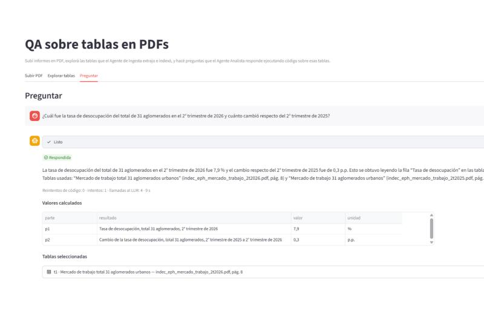
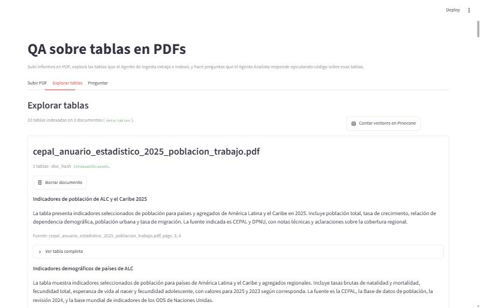
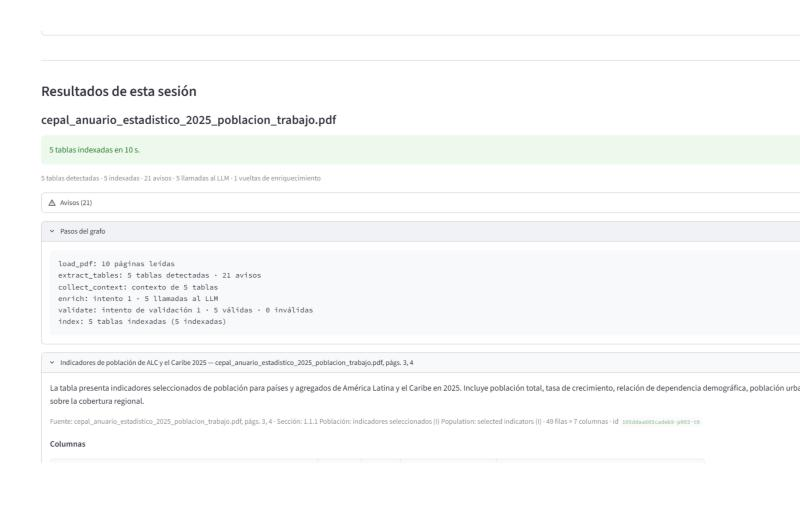
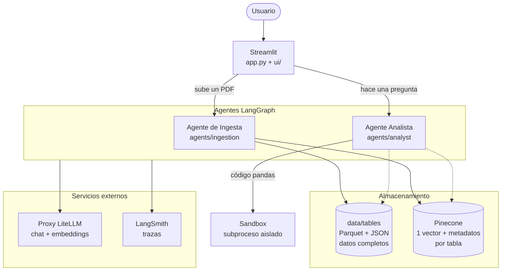
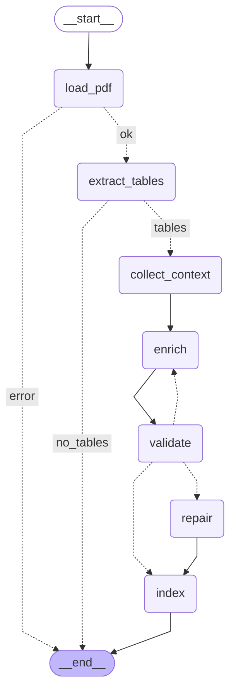
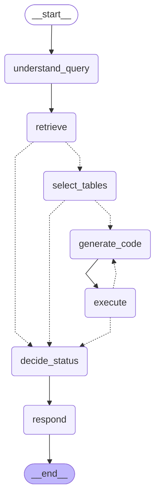

# QA multiagente sobre tablas en PDFs

Los datos más útiles de los informes públicos (anuarios, publicaciones estadísticas, estados
contables) suelen estar en tablas dentro de PDFs, donde son difíciles de encontrar y de usar para
hacer cuentas. Esta aplicación permite **subir PDFs legibles por máquina** y **hacer preguntas en
lenguaje natural** sobre sus tablas:

- un **Agente de Ingesta** (grafo LangGraph) extrae las tablas con PyMuPDF, une las que continúan en
  otra página, les genera metadatos con un LLM (validados con un ciclo de reintentos) y las indexa en
  Pinecone, guardando los datos en Parquet;
- un **Agente Analista** (otro grafo LangGraph) entiende la pregunta, recupera y selecciona una o más
  tablas, **escribe código pandas y lo ejecuta en un sandbox**, se autocorrige si el código falla y
  responde con un estado `answered`, `partial` o `cannot_answer`. Nunca inventa datos: si un período,
  una entidad, una conversión o un valor de comparación no está en las tablas, lo dice.

Todo corre localmente en una app Streamlit; las llamadas a LLM y embeddings pasan por el proxy
LiteLLM de la materia y cada ejecución queda trazada en LangSmith.



## Contenido

- [Instalación y ejecución](#instalación-y-ejecución)
- [Uso de la app](#uso-de-la-app)
- [Arquitectura](#arquitectura)
- [Decisiones de diseño](#decisiones-de-diseño)
- [PDFs de muestra](#pdfs-de-muestra)
- [Preguntas de prueba y evaluación](#preguntas-de-prueba-y-evaluación)
- [Limitaciones conocidas](#limitaciones-conocidas-y-troubleshooting)
- [Créditos](#créditos)

## Instalación y ejecución

Cada paso tiene los comandos para **Windows (PowerShell)** y para **Linux / macOS (bash)**; se corren
desde la raíz del repositorio. La diferencia es la ruta del venv (`.venv\Scripts\` en Windows,
`.venv/bin/` en Linux/macOS) y cómo se define una variable de entorno (`$env:VAR="valor"` en
PowerShell; `export VAR=valor`, o `VAR=valor comando` para un solo comando, en bash).

### Requisitos

- Python 3.11–3.13 (probado en CPython 3.13 sobre Windows 11).
- Una clave del **proxy LiteLLM** (URL + clave personal; las entrega el equipo docente).
- Una cuenta de **Pinecone** (plan Starter gratuito alcanza): <https://app.pinecone.io> → *API Keys*.
- Una cuenta de **LangSmith**: <https://smith.langchain.com> → *Settings* → *API Keys*.

### 1. Entorno virtual y dependencias

**Windows (PowerShell)**

```powershell
python -m venv .venv
.venv\Scripts\python -m pip install -r requirements.txt
```

**Linux / macOS (bash)**

```bash
python3 -m venv .venv
.venv/bin/python -m pip install -r requirements.txt
```

`requirements.txt` fija todas las dependencias directas con `==` (incluye `pytest` y `ruff`).

### 2. Configuración (`.env`)

**Windows (PowerShell)**

```powershell
Copy-Item .env.example .env
notepad .env
```

**Linux / macOS (bash)**

```bash
cp .env.example .env
nano .env
```

| Variable | Obligatoria | Default | Para qué / de dónde sale |
|---|---|---|---|
| `LITELLM_BASE_URL`, `LITELLM_API_KEY` | sí | — | URL y clave del proxy LiteLLM (equipo docente). |
| `LLM_MODEL` | sí | — | Modelo de chat. Usado: `gpt-5.4-mini` (con `temperature=0`). |
| `EMBEDDING_MODEL`, `EMBEDDING_DIM` | sí | — | Usado: `text-embedding-3-small`, `1536`. La dimensión debe coincidir con la del índice. |
| `PINECONE_API_KEY` | sí | — | Clave de Pinecone. |
| `PINECONE_INDEX_NAME` | no | `mas-2026s2-tables` | Índice serverless; se crea solo en la primera ingesta. |
| `PINECONE_CLOUD`, `PINECONE_REGION` | no | `aws`, `us-east-1` | Dónde crear el índice. |
| `LANGSMITH_API_KEY` | sí | — | Clave de LangSmith. |
| `LANGSMITH_PROJECT` | sí | — | Proyecto de trazas, p. ej. `mas-2026s2-<legajo>`. |
| `LANGSMITH_TRACING` | no | `true` | Trazas en cada ejecución. |
| `TABLES_DIR` | no | `data/tables` | Almacén local Parquet + JSON. |
| `MAX_ENRICH_RETRIES` / `MAX_CODE_RETRIES` | no | `2` / `3` | Reintentos de metadatos / de código. |
| `RETRIEVAL_TOP_K` | no | `5` | Tablas candidatas por consulta de búsqueda. |
| `SANDBOX_TIMEOUT_S` | no | `30` | Tiempo máximo de cada ejecución de código. |
| `LLM_CACHE` | no | `false` | Caché SQLite local de respuestas del LLM (`.langchain.db`). |
| `MAX_TABLES_PER_PDF` | no | `40` | Tope de tablas procesadas por PDF. |

**Durante el desarrollo usá la caché del LLM** para no gastar presupuesto del proxy repitiendo las
mismas llamadas. La variable del proceso gana sobre el `.env`:

**Windows (PowerShell)**

```powershell
$env:LLM_CACHE="true"
```

**Linux / macOS (bash)**

```bash
export LLM_CACHE=true
```

### 3. Ingerir los PDFs de muestra

Desde la app (pestaña **Subir PDF**, se pueden elegir varios archivos a la vez) o por consola:

**Windows (PowerShell)**

```powershell
.venv\Scripts\python -m agents.ingestion (Get-ChildItem data\sample_pdfs\*.pdf).FullName
```

**Linux / macOS (bash)**

```bash
.venv/bin/python -m agents.ingestion data/sample_pdfs/*.pdf
```

(PowerShell no expande comodines al llamar a programas externos; `(Get-ChildItem …).FullName` pasa
los tres PDFs como argumentos separados. En bash, `*.pdf` lo expande la shell.) La CLI muestra por PDF las tablas indexadas, sus avisos y
el id de la traza de LangSmith; termina con código 1 si algún PDF no quedó indexado. Reingerir un
PDF es seguro: los ids de las tablas dependen del contenido del archivo y no se duplican vectores.
La ingesta de los tres PDFs tarda ~1 minuto y hace ~33 llamadas al LLM (una por tabla).

### 4. Levantar la app

**Windows (PowerShell)**

```powershell
.venv\Scripts\streamlit run app.py
```

**Linux / macOS (bash)**

```bash
.venv/bin/streamlit run app.py
```

Se abre en <http://localhost:8501>. La primera carga tarda ~10 s (imports y una consulta a
Pinecone para validar el índice).

También se puede preguntar desde la consola (muestra el plan, las tablas, el código y la salida):

**Windows (PowerShell)**

```powershell
.venv\Scripts\python -m agents.analyst "¿Cuál fue la tasa de desocupación del total de 31 aglomerados urbanos en el 2° trimestre de 2026?"
```

**Linux / macOS (bash)**

```bash
.venv/bin/python -m agents.analyst "¿Cuál fue la tasa de desocupación del total de 31 aglomerados urbanos en el 2° trimestre de 2026?"
```

### 5. Tests y lint

**Windows (PowerShell)**

```powershell
.venv\Scripts\ruff check .
.venv\Scripts\python -m pytest -m "not integration"
```

**Linux / macOS (bash)**

```bash
.venv/bin/ruff check .
.venv/bin/python -m pytest -m "not integration"
```

La suite sin red (~340 tests) no usa claves ni servicios: LLM, embeddings, Pinecone y LangSmith se
reemplazan por fakes; el sandbox sí lanza subprocesos reales. Tarda ~30–55 s según la carga del
equipo; la primera corrida después de crear el entorno es más lenta (en una copia limpia: ~81 s la
primera vez, ~29 s la segunda).

Los tests de integración usan los servicios reales y el `.env`:

**Windows (PowerShell)**

```powershell
$env:LLM_CACHE="true"; .venv\Scripts\python -m pytest -m integration
```

**Linux / macOS (bash)**

```bash
LLM_CACHE=true .venv/bin/python -m pytest -m integration
```

Crean un índice temporal `<PINECONE_INDEX_NAME>-itest-<hex>` (lo borran al terminar), escriben en un
`TABLES_DIR` temporal y leen el índice principal en solo lectura (las preguntas reales necesitan los
PDFs de muestra ya ingeridos). Tardan ~3–4 minutos.

### 6. Evaluación

**Windows (PowerShell)**

```powershell
$env:LLM_CACHE="false"; .venv\Scripts\python -m eval.run_eval
```

**Linux / macOS (bash)**

```bash
LLM_CACHE=false .venv/bin/python -m eval.run_eval
```

Corre el Analista sobre las 11 preguntas de [`eval/questions.yaml`](eval/questions.yaml) (≈ 45
llamadas al LLM), guarda `eval/results/latest.json` y reescribe la tabla de resultados de
[`EVALUATION.md`](EVALUATION.md). Sin caché, para que latencias y llamadas sean reales. Variantes:

**Windows (PowerShell)**

```powershell
# re-correr algunas preguntas (no toca EVALUATION.md)
.venv\Scripts\python -m eval.run_eval --ids q05 q07
# reconstruir la tabla de EVALUATION.md desde resultados guardados, sin llamar al LLM
.venv\Scripts\python -m eval.run_eval --render eval\results\latest.json
```

**Linux / macOS (bash)**

```bash
# re-correr algunas preguntas (no toca EVALUATION.md)
.venv/bin/python -m eval.run_eval --ids q05 q07
# reconstruir la tabla de EVALUATION.md desde resultados guardados, sin llamar al LLM
.venv/bin/python -m eval.run_eval --render eval/results/latest.json
```

### Herramientas auxiliares

**Windows (PowerShell)**

```powershell
# qué tablas extraería la ingesta de un PDF (sin LLM ni red)
.venv\Scripts\python scripts\inspect_pdf.py data\sample_pdfs\indec_eph_mercado_trabajo_2t2026.pdf --context
# diagramas de los grafos con draw_mermaid(); --check compara con los de este README
.venv\Scripts\python scripts\mermaid_graphs.py --check
```

**Linux / macOS (bash)**

```bash
# qué tablas extraería la ingesta de un PDF (sin LLM ni red)
.venv/bin/python scripts/inspect_pdf.py data/sample_pdfs/indec_eph_mercado_trabajo_2t2026.pdf --context
# diagramas de los grafos con draw_mermaid(); --check compara con los de este README
.venv/bin/python scripts/mermaid_graphs.py --check
```

## Uso de la app



- **Subir PDF**: se suben uno o más PDFs y se pulsa *Ingerir*. Mientras corre se ve el nodo del
  grafo en curso con contadores (tablas detectadas, vuelta de validación, inválidas). Al terminar,
  por tabla: nombre, descripción, columnas (tipo, unidad, descripción), encabezados de fila, vista
  previa de 5 filas, páginas de origen y calidad de metadatos (`ok` / `degraded`), más la lista de
  avisos (páginas sin texto, imágenes grandes, tablas descartadas).

  

- **Explorar tablas**: catálogo de todo lo indexado, agrupado por documento, con la tabla completa
  en un desplegable, el conteo de vectores en Pinecone y un botón para **borrar un documento**
  (borra sus vectores y sus archivos locales, con confirmación).
- **Preguntar**: chat de la sesión. Cada respuesta muestra el texto, un badge de estado, los valores
  calculados, los datos faltantes (si no es `answered`), las tablas elegidas con sus datos, el
  código generado, la salida de la ejecución, la cantidad de reintentos y un link a la traza de
  LangSmith. Las preguntas vacías o de más de 1 000 caracteres se rechazan sin llamar al Analista.

Cualquier error de LiteLLM, Pinecone o LangSmith se muestra como un mensaje con el servicio y un
resumen (con las claves ocultas); la app sigue funcionando y el historial no se pierde.

## Arquitectura



Hacia el almacenamiento, la línea continua es la Ingesta **escribiendo** (Parquet + JSON local y un
vector con metadatos en Pinecone) y la punteada es el Analista **leyendo** (busca en Pinecone y
carga los Parquet de las tablas elegidas). Los dos agentes llaman al LLM y a los embeddings por el
proxy LiteLLM y dejan una traza por ejecución en LangSmith.

**Estructura del repositorio**

```
.
├── app.py                  # punto de entrada de Streamlit (sin lógica propia)
├── ui/                     # pestañas, render, manejo de errores, armado de dependencias
├── agents/
│   ├── ingestion/          # grafo, nodos, prompts, schemas, validación de metadatos, CLI
│   └── analyst/            # grafo, nodos, prompts, schemas, decisión de estado, CLI
├── services/               # config, LiteLLM + caché, extracción PDF, normalización,
│                           # almacén Parquet/JSON, Pinecone, sandbox, trazas
├── eval/                   # preguntas de prueba, runner de evaluación y resultados
├── scripts/                # inspección de PDFs y diagramas Mermaid
├── data/
│   ├── sample_pdfs/        # PDFs de muestra + SOURCES.md
│   └── tables/             # tablas ingeridas, Parquet + JSON (generado, no versionado)
├── tests/
│   ├── unit/               # sin red ni claves (fakes)
│   ├── integration/        # contra los servicios reales
│   └── fixtures/           # PDFs generados para los tests
├── specs/                  # especificación, plan y registro de decisiones
├── assets/                 # capturas usadas en este README
├── .env.example
├── requirements.txt
├── EVALUATION.md
└── README.md
```

Los estados de ambos grafos son `TypedDict`, y todo lo que devuelve el LLM se parsea con modelos
Pydantic vía `with_structured_output`. Las dependencias (chat, embeddings, Pinecone, almacén,
sandbox) se inyectan, así los tests unitarios corren los grafos completos con fakes.

### Grafo de Ingesta

Generado con `build_ingestion_graph(deps).get_graph().draw_mermaid()`:

<!-- mermaid:ingestion -->


| Nodo | Qué hace |
|---|---|
| `load_pdf` | Abre el PDF, calcula `doc_hash` (SHA-256 de los bytes) y lee los bloques de texto con sus coordenadas. Un archivo que no es PDF, está truncado o encriptado termina el grafo (`error`) sin escribir nada. |
| `extract_tables` | `find_tables()` de PyMuPDF por página; reconstruye encabezados de varios niveles, normaliza números y faltantes, une tablas que continúan en la página siguiente y descarta falsos positivos. Avisa páginas sin capa de texto e imágenes grandes (posibles tablas en imagen, que no se procesan). Sin tablas → `no_tables`, sin tocar Pinecone. |
| `collect_context` | Por tabla: epígrafe/título arriba, notas y fuente abajo, y el título de sección más cercano (≤ 2 000 caracteres). |
| `enrich` | El LLM genera `name`, `description`, `columns` (descripción, tipo, unidad) y `row_headers` (`TableEnrichment`). Solo para las tablas pendientes o inválidas, en paralelo, con los errores del intento anterior como feedback. |
| `validate` | Reglas deterministas: mismas columnas y en el mismo orden que el DataFrame, rótulos de fila existentes, largo del nombre, 2–4 oraciones de descripción, tipos compatibles. |
| `repair` | Si una tabla agota los reintentos: conserva nombre y descripción, reconstruye las columnas desde el DataFrame y la marca `degraded` (la UI lo avisa). |
| `index` | Guarda `<table_id>.parquet` + `<table_id>.json`, genera los embeddings en lote, hace upsert en Pinecone y borra las tablas de ese documento que ya no aparecen. |

Aristas condicionales: `validate → enrich` mientras quede alguna tabla inválida con intentos
(≤ `1 + MAX_ENRICH_RETRIES` llamadas por tabla); si no, `repair` (si quedan inválidas) o `index`.
El estado (`IngestionState`) lleva el PDF, las páginas, los borradores de tabla (DataFrame, páginas,
contexto, metadatos, errores, intentos, estado), los avisos, los registros indexados y contadores.

### Grafo Analista

Generado con `build_analyst_graph(deps).get_graph().draw_mermaid()`:

<!-- mermaid:analyst -->


| Nodo | Qué hace |
|---|---|
| `understand_query` | El LLM divide la pregunta en partes `p1…pn` (métricas, entidades, períodos, operación y 1–3 consultas de búsqueda cada una) → `QueryPlan`. |
| `retrieve` | Embebe todas las consultas en **una** llamada, consulta Pinecone (top-k por consulta), deduplica por tabla con el score máximo y descarta candidatas sin datos locales (con aviso). |
| `select_tables` | El LLM recibe metadatos completos + vista previa de cada candidata y elige una o más tablas, marcando cada parte `covered` o `missing` con el motivo y la tabla relacionada (`TableSelection`). Puede combinar tablas de distintas publicaciones. |
| `generate_code` | El LLM escribe un programa pandas que usa `tables["t1"]`, `tables["t2"]`… con los nombres **exactos** de columnas, dtypes, unidades, la primera columna fila por fila y `df.head(5)`; imprime como última línea un JSON con `results`, `missing` y `conversions`. |
| `execute` | Corre el código en el sandbox y valida el JSON de salida. |
| `decide_status` | Función pura: `answered` si todas las partes tienen resultado, `partial` si algunas, `cannot_answer` si ninguna. El LLM no decide el estado. |
| `respond` | El LLM redacta la respuesta en español: resultados, tablas y páginas usadas, explicación del cálculo, conversiones y qué falta. Con `cannot_answer` no hay números. |

Aristas condicionales: `retrieve → decide_status` si no hay candidatas; `select_tables →
decide_status` si ninguna parte quedó `covered` (no se genera código); `execute → generate_code`
mientras la ejecución falle (error, timeout, código rechazado o salida inválida) y queden intentos
(≤ `1 + MAX_CODE_RETRIES`), con el código anterior y el error como feedback. Al agotarlos, las partes
pasan a `missing` con el motivo. El estado (`AnalystState`) lleva pregunta, plan, candidatas,
selección, código, intentos, ejecución (stdout, stderr, returncode, duración, JSON parseado),
resultados, faltantes, conversiones, estado y respuesta.

Una pregunta hace como máximo `4 + MAX_CODE_RETRIES` llamadas de chat y 1 de embeddings.

### Observabilidad

Cada ingesta es una traza raíz `ingestion:<archivo>` con un span por nodo (incluida cada vuelta de
`enrich`/`validate`) y metadata `doc_hash`, `n_tables`, `n_warnings` (más `n_indexed`, `n_degraded`,
`llm_calls`, `status`). Cada pregunta es una traza `analyst:<primeros 60 caracteres>` con un span por
nodo (cada intento de `generate_code`/`execute` aparte) y metadata `status`, `selected_table_ids`,
`code_attempts`. Las entradas se sanean antes de subirlas: los bytes del PDF y los DataFrames se
reemplazan por resúmenes (tamaño, forma y columnas).

## Decisiones de diseño

**Extracción con PyMuPDF (`find_tables`), sin librería de respaldo.** Detecta todas las tablas de
datos de los PDFs de muestra. Lo que no resolvía bien eran los encabezados: INDEC los dibuja aparte
de la grilla y CEPAL usa 4 niveles con celdas combinadas, así que el encabezado se reconstruye a
partir de las palabras y las rayas de la página y se aplana en una sola fila (`"2023 - Ene"`),
con nombres únicos y estables, que es lo que necesita el código generado. Los cuadros "cebra" sin
rayas verticales (filas de fondo gris alternado, como en los informes de pobreza del INDEC) también
se reparan: `find_tables` solo arma celdas en las filas grises, así que las filas blancas se
rearman con las palabras de la página y los límites de columna de las filas bien detectadas, y un
encabezado escrito solo sobre la columna de valores ("1º semestre de 2026*") se acepta. Las heurísticas usan
umbrales en puntos; un PDF con otro diseño puede pedir ajustarlos (`scripts/inspect_pdf.py` muestra
lo que se extrae).

**Normalización numérica por documento.** El separador decimal se infiere por columna, con el del
documento como respaldo (INDEC usa `48,9` y `30.158`; CEPAL `45 851.4`). Las llamadas a nota pegadas
a números (`45,4 (1)`, `667 888.6b`) se quitan, `-`, `…`, `s/d` y similares son `NaN` (nunca 0), y
las columnas de años quedan como enteros.

**Tablas multipágina.** Una tabla en la página *n+1* continúa la última de la página *n* si es la
primera de su página, tiene la misma cantidad de columnas y repite el encabezado (o empieza con
datos numéricos), **salvo que tenga su propio epígrafe** ("Cuadro 2.3…") encima: en INDEC todos los
cuadros comparten encabezado y sin esa excepción se unían cuadros distintos.

**Almacén Parquet + JSON, no metadata de Pinecone.** Cada tabla se guarda como
`data/tables/<table_id>.parquet` (los datos, con dtypes preservados: recargar no requiere volver a
inferir tipos) y `<table_id>.json` (el registro de metadatos, que es también el catálogo de la
pestaña Explorar). Pinecone guarda metadatos y una vista previa de 5 filas para la selección, pero no
los datos: su metadata está limitada a 40 KB por vector y solo admite texto, números y listas de
texto. Las escrituras son atómicas (archivo temporal + reemplazo).

**Una tabla = un vector.** El texto embebido describe *qué mide* la tabla, no sus valores: nombre,
descripción, columnas con unidad, los primeros 50 rótulos de fila, fuente con páginas y sección. Las
preguntas buscan métricas, entidades y períodos, y la tabla es la unidad que se le pasa al código.
La recuperación hace una llamada de embeddings por pregunta (todas las consultas juntas) y no usa un
umbral de score: el selector descarta las candidatas sin relación.

**Ids idempotentes.** `table_id = <primeros 16 caracteres del SHA-256 del PDF>-p<página>-t<índice>`.
Reingerir el mismo PDF (aunque tenga otro nombre) reemplaza los mismos vectores y archivos, y borra
los de ese documento que ya no aparecen. El orden de `index` (abrir el índice → archivos →
embeddings → upsert tabla por tabla → borrar obsoletos) hace que una falla nunca borre lo que ya
estaba indexado, y que se pueda informar cuántas tablas quedaron indexadas; reingerir completa la
ingesta sin duplicados. Un PDF sin tablas o inválido nunca toca Pinecone.

**Reintentos acotados y por tabla.** El enriquecimiento reintenta solo las tablas inválidas
(`MAX_ENRICH_RETRIES`, default 2) y el código hasta `MAX_CODE_RETRIES` veces (default 3). Una salida
del LLM que no parsea cuenta como intento fallido; un error del proxy (conexión, autenticación,
presupuesto) corta la ejecución y se muestra en la UI, en lugar de degradar todo en silencio.

**Estado determinístico.** `decide_status(plan, selection, execution)` es una función pura: una
parte cuenta como respondida solo si el selector la cubrió **y** el código devolvió un valor finito
para ella. El código reporta en `missing` lo que no está (período, entidad, comparación o
conversión que requiere datos externos) en lugar de interpolar o estimar. La salida del LLM se
normaliza en código (ids de partes, ids de tablas que no eran candidatas, partes sin evaluar).

**Sandbox: chequeo estático + subproceso + guardas de runtime, sin Docker.**
1. Un chequeo AST rechaza, antes de ejecutar, imports fuera de una lista permitida (`pandas`,
   `numpy`, `math`, `statistics`, `json`, `datetime`, `re`, `collections`, `itertools`,
   `functools`, `decimal`, `fractions`), `open`/`exec`/`eval`/`__import__`/builtins de
   introspección, atributos `__*`, funciones de E/S de pandas/numpy (`read_*`, `to_csv`,
   `np.load`…) y atributos que llevan a módulos del sistema (`pd.io.common.os…`).
2. El código corre con `python -I -X utf8` en un subproceso cuyo directorio de trabajo temporal
   contiene solo los Parquet de las tablas elegidas, con un entorno mínimo (sin ninguna variable del
   `.env`), salida recortada a 20 000 caracteres y timeout que mata el árbol de procesos completo.
3. Un preámbulo fijo (no el LLM) carga `tables` y después reemplaza `open` y los sockets por
   funciones que lanzan `PermissionError`.


**Modelos.** `gpt-5.4-mini` con `temperature=0` y `text-embedding-3-small` (1536 dimensiones),
elegidos con `notebooks/00_litellm_exploracion.ipynb`: todos los candidatos pasaron salida
estructurada, tool calling y generación de código; este fue el más rápido, y ese modelo de
embeddings separó mejor textos relacionados de no relacionados. `gpt-4.1-mini` funciona como
respaldo cambiando solo el `.env`. Cambiar de modelo de embeddings obliga a recrear el índice (la
app avisa si la dimensión no coincide y no escribe).

**Caché SQLite propia.** `LLM_CACHE=true` instala una caché en `.langchain.db` implementada sobre
`sqlite3` (sin `langchain-community`), que también funciona con salida estructurada. El nombre del
archivo va en el prompt de enriquecimiento: reingerir con otro nombre no aprovecha la caché.

**UI sin lógica propia.** `app.py` solo arma la página; todo lo testeable vive en `ui/` con los
agentes inyectados. Al arrancar se valida el índice **en solo lectura** (no se crea hasta la primera
ingesta). Las tablas de datos se dibujan solo cuando se abre su desplegable, para que Explorar no
mande decenas de tablas ocultas al navegador.

## PDFs de muestra

En [`data/sample_pdfs/`](data/sample_pdfs/) (detalle, recorte y particularidades en
[`SOURCES.md`](data/sample_pdfs/SOURCES.md)). Los tres tienen capa de texto.

| Archivo | Publicación | Páginas | Fuente |
|---|---|---|---|
| `indec_eph_mercado_trabajo_2t2026.pdf` | INDEC, *Mercado de trabajo. Tasas e indicadores socioeconómicos (EPH). Segundo trimestre de 2026* | 26 (completo) | <https://www.indec.gob.ar/uploads/informesdeprensa/mercado_trabajo_eph_2trim26433FCBC5A8.pdf> |
| `indec_eph_mercado_trabajo_2t2025.pdf` | INDEC, ídem, *Segundo trimestre de 2025* | 23 (completo) | <https://www.indec.gob.ar/uploads/informesdeprensa/mercado_trabajo_eph_2trim25C42A813B2A.pdf> |
| `cepal_anuario_estadistico_2025_poblacion_trabajo.pdf` | CEPAL, *Anuario Estadístico de América Latina y el Caribe 2025*, extracto: 1.1 Población y 1.2 Trabajo | 10 (págs. 15–24 de 175) | <https://repositorio.cepal.org/server/api/core/bitstreams/b2476d6d-34cd-4e70-a7b7-d39e244a9070/content> |

La **tabla multipágina** es el cuadro 1.1.1 de CEPAL (págs. 3–4 del extracto, con el encabezado
repetido), que la ingesta une en una tabla de 49 filas. La ingesta produce 33 tablas (16 + 12 + 5).

## Preguntas de prueba y evaluación

[`eval/questions.yaml`](eval/questions.yaml) tiene 11 preguntas con estado esperado, valores esperados
(calculados a mano desde los PDFs, con página y cuadro), tolerancia y tablas esperadas: 4 que
necesitan más de una tabla (dos ediciones de la EPH, o INDEC + CEPAL), una sin ninguna tabla
relacionada, y varias con tabla relacionada pero sin el período, el valor de comparación o el dato
externo necesario.

Resultado de la última corrida completa: **9/11 correctas (81,8 %)**, latencia mediana 15,2 s y
máxima 19,9 s, ≤ 4 llamadas de chat por pregunta. El informe completo, con el análisis de cada
falla y las trazas representativas, está en [`EVALUATION.md`](EVALUATION.md).

## Limitaciones conocidas y troubleshooting

- **Sandbox:** aísla el código generado en un subproceso con timeout, sin red ni acceso a archivos,
  pero no es una frontera de seguridad del sistema operativo (no limita memoria ni CPU y el chequeo
  del código usa listas de bloqueo). Sirve para contener errores del LLM, no ataques.
- **Calidad de las respuestas:** la recuperación depende de cómo el LLM nombró y describió cada
  tabla, así que a veces la tabla con el dato no aparece entre las candidatas. Aun con
  `temperature=0` hay variación entre corridas, y la forma en que se divide la pregunta en partes
  puede cambiar el estado final (`partial` o `cannot_answer`). No hay tope de candidatas para el
  selector: con muchos más documentos habría que agregarlo. Detalle en `EVALUATION.md`.
- **Extracción:** sin OCR (las páginas sin capa de texto se saltean con aviso). La detección de
  tablas y encabezados usa heurísticas con umbrales fijos; un PDF con un diseño muy distinto puede
  requerir ajustes. Algunos nombres de tabla generados no incluyen el período.
- **Entorno:** probado solo con CPython 3.13 en Windows 11. Algunas APIs de `langsmith` que se
  usan están marcadas como deprecadas.


## Créditos

- [PyMuPDF](https://pymupdf.readthedocs.io/) (extracción de texto y tablas),
  [LangChain](https://python.langchain.com/) y [LangGraph](https://langchain-ai.github.io/langgraph/)
  (grafos, clientes de LLM, salida estructurada), [Pinecone](https://www.pinecone.io/) (índice
  vectorial), [LangSmith](https://smith.langchain.com/) (trazas), [Streamlit](https://streamlit.io/)
  (UI), pandas, NumPy y PyArrow (datos), psutil (control del árbol de procesos del sandbox).
- Datos de muestra: [INDEC](https://www.indec.gob.ar/) (Encuesta Permanente de Hogares, informes de
  mercado de trabajo) y [CEPAL](https://www.cepal.org/) (Anuario Estadístico de América Latina y el
  Caribe 2025). Los PDFs se redistribuyen sin modificaciones, salvo el recorte de páginas del anuario.
- No se copió código de tutoriales ni templates externos; se siguió la documentación oficial de cada
  librería.
- **Uso de asistentes de IA:** el proyecto se desarrolló con la ayuda de un asistente de
  programación con IA (Claude Code, de Anthropic), que se usó para redactar la especificación,
  planificar, escribir código, tests y documentación bajo revisión del autor.
