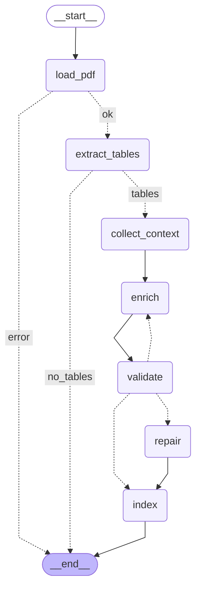

# Iteración 5 — Grafo de Ingesta (enriquecimiento, validación, reintentos, trazas)

- **Fecha:** 2026-10-07 · **Rama:** `feat/qa-tablas`
- **SHA:** ver `git log -1 --format=%H -- specs/qa-tablas-pdf-spec-plan-artifacts/iterations/05-ingestion-graph.md` (D-003)
- **Commit:** `feat(ingesta): grafo LangGraph con enriquecimiento, validación con reintentos e indexación`

## Criterios de éxito

Criterios 1, 2 y 5–8: corrida final con todo en stage, justo antes del commit (Git Bash desde la raíz; en PowerShell, mismos comandos con `\`; integración con `LLM_CACHE=true`). Criterios 3 y 4 (escriben en producción) se corrieron una vez durante la iteración, después del arreglo de la caché no se repitieron para no regenerar los metadatos del inventario; el estado se verificó al final (33 vectores, 66 archivos).

| # | Criterio | Comando | Resultado |
|---|---|---|---|
| 1 | VC-022, 023, 024, 025 (nodo index), 030, 031, 032, 033 | `.venv\Scripts\python -m pytest tests/unit/test_ingestion_validate.py tests/unit/test_ingestion_graph.py -v` | PASS (42 passed, ~2 s). VC-022: `test_vc022_*` (válido; reglas 1–6, una por caso, más decimales y dtypes numéricos); VC-023: `test_vc023_invalid_then_valid_retries_enrich_with_error_feedback`; VC-024: `test_vc024_always_invalid_exhausts_retries_and_repairs_as_degraded`; VC-025: `test_vc025_index_node_writes_parquet_json_and_upserts_by_table_id`; VC-030: `test_vc030_pdf_without_tables_writes_nothing`; VC-031: `test_vc031_invalid_pdf_stops_at_load_pdf[txt/truncado/encriptado]`; VC-032: `test_vc032_max_tables_per_pdf_limits_enrichment`; VC-033: `test_vc033_partial_pinecone_failure_then_reingest_completes_without_duplicates`. Extra: BR-008, reintento por tabla, salida no parseable, error no recuperable, falla de embeddings / índice, FR-024 con obsoletos, stream, mermaid |
| 2 | VC-021, VC-027 (reingesta real con otro nombre), VC-080 | `.venv\Scripts\python -m pytest -m integration tests/integration/test_ingestion_real.py -v` | PASS (3 passed, ~32 s). PDF real reducido (CEPAL págs. 8–9, 2 tablas) en índice efímero creado por el propio nodo `index` y `TABLES_DIR` temporal: VC-021 `TableEnrichment` con `len(columns) == n_cols` (y 0 errores BR-007); VC-027 N=2 → reingesta como `…_renombrado.pdf` → mismos ids, 2 vectores; VC-080 `list_runs(is_root=True)` encuentra `ingestion:itest_cepal_trabajo.pdf` (id = `run_id`), hijos `load_pdf…index` (un `enrich`/`validate` por vuelta), metadata `doc_hash`, `n_tables`, `n_warnings`, entrada `pdf_bytes` saneada. Después: `list_indexes()` = `['mas-2026s2-tables']` (el efímero se borró) |
| 3 | CLI sobre cada PDF; `data/tables/` con `.parquet` + `.json` por tabla | `.venv\Scripts\python -m agents.ingestion data/sample_pdfs/indec_eph_mercado_trabajo_2t2026.pdf data/sample_pdfs/indec_eph_mercado_trabajo_2t2025.pdf data/sample_pdfs/cepal_anuario_estadistico_2025_poblacion_trabajo.pdf` | PASS (exit 0; 16 + 12 + 5 = 33 tablas `ok`; `ls data/tables/*.parquet \| wc -l` = 33, `*.json` = 33). El índice de producción se creó en esta corrida (FR-003) |
| 4 | Idempotencia en producción | `python -m agents.ingestion data/sample_pdfs/cepal_…pdf` (×3, una con `--as-name cepal_reingesta.pdf`) + `count_vectors(ensure_index(settings), expected=33)` | PASS: 33 vectores antes y después de cada reingesta; 66 archivos en `data/tables/`. Estado final: reingesta con el nombre original |
| 5 | NFR-007 con fakes | `pytest tests/unit/test_ingestion_graph.py -k nfr007` (incluido en 1) | PASS: con 2 tablas siempre inválidas y `MAX_ENRICH_RETRIES` ∈ {0, 1, 3}, exactamente `1 + MAX` llamadas por tabla y 1 llamada de embeddings |
| 6 | Suite sin red | `.venv\Scripts\python -m pytest -m "not integration"` | PASS (195 passed, 14 deselected, ~6 s) |
| 7 | Lint | `.venv\Scripts\ruff check .` | PASS ("All checks passed!") |
| 8 | Secretos | `git grep -nE "(sk-[A-Za-z0-9]{16,}\|pcsk[_]\|lsv2[_])"` y `git grep --cached -nE ...`; `git ls-files .env` | PASS (vacíos, exit 1; `.env` no trackeado; `data/tables/` y `.langchain.db` ignorados) |
| 9 | Artefactos | revisión | PASS: este record (comandos, mermaid, inventario), `CONTEXT.md` reescrito, D-021..D-025 |

Regresión adicional: `pytest tests/integration/test_sample_pdfs.py` PASS (6 passed). Ningún criterio dio FAIL. Problema encontrado y corregido antes de la corrida final: la caché SQLite nunca acertaba con salida estructurada (D-025).

## Grafo (`build_ingestion_graph(deps).get_graph().draw_mermaid()`)

## Ingesta real en producción (índice `mas-2026s2-tables`, 33 vectores)

| PDF | Tablas | Llamadas de chat | Tiempo | Degradadas | Run raíz LangSmith |
|---|---|---|---|---|---|
| `indec_eph_mercado_trabajo_2t2026.pdf` | 16 | 16 | 33,7 s (incluye crear el índice) | 0 | `5ff8d853-72a8-43bd-a8eb-c96115929217` |
| `indec_eph_mercado_trabajo_2t2025.pdf` | 12 | 12 | 19,8 s | 0 | `f5b82ff9-24f7-4fa1-b8fa-171fd03982a6` |
| `cepal_anuario_estadistico_2025_poblacion_trabajo.pdf` | 5 | 5 (0 nuevas en la última, caché) | 11,9 s; 6,1 s con caché | 0 | `85f9929d-7c03-4729-978a-3ccdfeb3d0c3` (última) |

Ninguna tabla necesitó reintento ni quedó `degraded`. Embeddings: 1 llamada por PDF. Llamadas LLM de toda la iteración ≈ 65 (smoke, integración, 33 de producción, 3 reingestas de CEPAL, prueba de caché).

**Revisión a mano de los metadatos:** nombres y descripciones razonables y fieles al contexto (período, cobertura "31 aglomerados urbanos", fuente INDEC/CEPAL); unidades correctas (`%`, `miles de personas`, `por cada 1.000 habitantes`, `hijos por mujer`); dtypes `percent`/`number`/`text` coherentes. Observaciones: (1) algunos nombres no traen el período y se repiten entre las dos EPH ("Principales tasas del mercado de trabajo"): el período está en la descripción, la sección y los nombres de columna, que van al texto de embedding; (2) Cuadro 1.3 mezcla filas de población (miles) y tasas (%), unidad "miles de personas o %"; (3) `row_headers` de INDEC incluyen filas de subtítulo; (4) EPH 2T2025 p004 tiene sección equivocada (bloque en negrita del resumen) y una fila sin rótulo; (5) CEPAL: rótulos con notas pegadas (`Argentinab`) y columnas en inglés (`Country`, `Age`).

## Inventario de tablas ingeridas (insumo de la Iteración 10)

`table_id` · páginas · filas×columnas · calidad · nombre (todas `ok`)

**`indec_eph_mercado_trabajo_2t2026.pdf`** (doc `b0a700bac4db8192`)
p005-t0 · 5 · 9×6 · Principales tasas del mercado de trabajo — p007-t0 · 7 · 10×6 · Presión sobre el mercado de trabajo en 31 aglomerados — p008-t0 · 8 · 48×6 · Mercado de trabajo total 31 aglomerados urbanos (Cuadro 1.3) — p009-t0 · 9 · 53×6 · Composición de la tasa de empleo por grupo y rama — p010-t0 · 10 · 57×6 · Caracterización de la población ocupada — p012-t0 · 12 · 54×6 · Composición de la tasa de desocupación por grupo — p014-t0 · 14 · 50×6 · Caracterización de desocupados urbanos — p015-t0 · 15 · 16×6 · Composición del empleo por formalidad, 31 aglomerados urbanos — p015-t1 · 15 · 10×6 · Población ocupada según formalidad y sector — p016-t0 · 16 · 9×6 · Población ocupada por sector y formalidad — p016-t1 · 16 · 8×6 · Tasas de informalidad por categoría ocupacional — p016-t2 · 16 · 7×6 · Caracterización de la informalidad laboral — p017-t0 · 17 · 11×8 · Indicadores laborales regionales EPH 2T 2026 — p018-t0 · 18 · 43×8 · Principales indicadores laborales por área geográfica (aglomerados) — p019-t0 · 19 · 43×7 · Población de referencia por región y condición (en miles, por aglomerado) — p020-t0 · 20 · 43×5 · Tasa de desocupación por región urbana (con CV e IC 90 %).

**`indec_eph_mercado_trabajo_2t2025.pdf`** (doc `2c14158b26aed2d1`)
p004-t0 · 4 · 4×6 · Indicadores de ocupación EPH por trimestre — p005-t1 · 5 · 7×6 · Principales tasas del mercado de trabajo — p006-t0 · 6 · 10×6 · Presión sobre el mercado de trabajo, 31 aglomerados — p008-t0 · 8 · 48×6 · Mercado de trabajo 31 aglomerados urbanos (Cuadro 1.3) — p009-t0 · 9 · 76×6 · Composición de la tasa de empleo por características — p011-t0 · 11 · 73×6 · Caracterización de la población ocupada por trimestre — p012-t0 · 12 · 58×6 · Composición de la desocupación por perfil socioeconómico — p014-t0 · 14 · 55×6 · Caracterización de la población desocupada — p015-t0 · 15 · 11×8 · Indicadores laborales regionales, 2º trimestre 2025 — p016-t0 · 16 · 43×8 · Tasas de actividad y empleo por aglomerado urbano, 2T 2025 — p017-t0 · 17 · 43×7 · Población EPH por aglomerado urbano (en miles) — p018-t0 · 18 · 43×5 · Tasa de desocupación por aglomerado urbano, 2º trimestre 2025.

**`cepal_anuario_estadistico_2025_poblacion_trabajo.pdf`** (doc `105ddaa685cadeb9`)
p003-t0 · 3–4 · 49×7 · Indicadores de población de ALC y el Caribe 2025 (1.1.1, multipágina) — p006-t0 · 6 · 49×7 · Indicadores demográficos de países de ALC (1.1.4) — p008-t0 · 8 · 24×5 · Tasas laborales por país, 2024 (1.2.1) — p009-t0 · 9 · 6×5 · Tasa de participación laboral en América Latina por sexo y edad, 2024 (1.2.2) — p010-t0 · 10 · 10×5 · Ocupados urbanos de baja productividad por sexo, 2024 (1.2.5).

`table_id` completo = `<doc>-<ref>`, p. ej. `b0a700bac4db8192-p008-t0`.

## Archivos

Agregados: `agents/ingestion/{state,validation,prompts,nodes,graph,__main__}.py`, `services/tracing.py`, `tests/unit/test_ingestion_validate.py`, `tests/unit/test_ingestion_graph.py`, `tests/unit/test_tracing.py`, `tests/integration/test_ingestion_real.py`, este record.
Cambiados: `services/llm.py` (D-025) + `tests/unit/test_llm.py`; `services/pdf_extract.py` (`trace_summary()` en `PageText` y `RawTable`); `tests/tables.py` (`fake_settings`, `valid_enrichment`); `CONTEXT.md`, `DECISIONS.md` (D-021..D-025). Incluido del orquestador: spec v0.7 (§7.4 `pages` como `list[str]`, D-018). Sin dependencias nuevas (`langgraph==1.2.14` ya estaba fijado).

## Desvíos del plan

1. **`agents/ingestion/validation.py`** (no está en el layout del plan): `validate_enrichment` y `repair_enrichment` como funciones puras separadas de los nodos (D-024).
2. **`run_ingestion(..., on_update)`** además de `ingest_pdf`: la UI necesita los eventos del stream y el resultado final en una sola ejecución.
3. **Arreglo en `services/llm.py`** (Iteración 1): la caché no servía para salida estructurada (D-025). Necesario para el presupuesto (regla 9 del plan).
4. **VC-027/VC-080 sobre un PDF real reducido** (2 páginas de CEPAL) en lugar de un PDF completo, para gastar ~2 llamadas por ingesta (pedido del orquestador).

## Problemas encontrados / gotchas

- `ChatOpenAI.with_structured_output` (json_schema) + caché: ver D-025. Tras el arreglo, una reingesta idéntica cuesta 0 llamadas.
- `client.list_runs`/`read_run` de `langsmith` 0.14 emiten `DeprecationWarning` (migrar a `client.runs.query()` antes de 2027); el test los silencia. Las trazas tardan pocos segundos en aparecer: el test hace polling hasta 120 s.
- El estado del grafo incluye `pdf_bytes`, `DataFrame`s y páginas: sin el saneado de D-022 cada span subiría el PDF entero.
- Las funciones de ruteo (`_route_after_load`, …) aparecen como runs en LangSmith, colgadas del nodo anterior, no del raíz.
- La reingesta con `--as-name` cambia `source.file_name` en Pinecone y `data/tables/` (los ids no cambian): para dejar el estado limpio se reingirió con el nombre original.
- Nombres de columna de INDEC largos y repetidos salvo el sufijo de trimestre (`… - Año 2025 - 2° trimestre`): el prompt los lista como JSON con índice y el LLM los copió bien en las 33 tablas.

## For the next iteration

- **Iteración 6 (sandbox):** cargar tablas con `TableStore(settings.tables_dir).load_table(id)` / `parquet_path(id)` (los Parquet ya existen para las 33 tablas). Nombres de columna con `*`, `°`, `/` y espacios: el preámbulo debe usar los nombres tal cual.
- **Iteración 7 (Analista):** `make_trace_setup(settings, run_name=f"analyst:{question[:60]}", metadata=..., root_metadata=lambda state: {"status": ..., "selected_table_ids": ..., "code_attempts": ...})` + `with setup.activate(): graph.stream/invoke(..., setup.config)` + `setup.flush()` (D-022). Metadata de candidatas con `decode_metadata(match.metadata)`; `preview_csv` ya está en Pinecone. Dos EPH con tablas casi iguales (2T2025 vs 2T2026): la selección debe mirar `file_name`, sección y nombres de columna (períodos) para elegir la correcta. Cuadro 1.3 mezcla miles y % por fila. Filas de subtítulo con `NaN` en INDEC.
- Deps inyectables al estilo de `IngestionDeps` (chat, embeddings, vector store, table store); fakes en `tests/fakes.py`; `fake_settings` apaga trazas en tests.
- Usar `LLM_CACHE=true` (variable de proceso) en desarrollo; con la caché arreglada los prompts repetidos no gastan.
