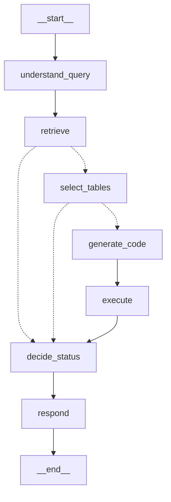

# Iteración 7 — Analista: entender, recuperar, seleccionar y decidir estado

- **Fecha:** 2026-10-07 · **Rama:** `feat/qa-tablas`
- **SHA:** ver `git log -1 --format=%H -- specs/qa-tablas-pdf-spec-plan-artifacts/iterations/07-analyst-selection.md` (D-003)
- **Commit:** `feat(analista): comprensión de consulta, recuperación, selección de tablas y estado determinístico`

## Criterios de éxito

Corrida final con todo en stage, justo antes del commit (PowerShell desde la raíz, `$env:LLM_CACHE="true"`).

| # | Criterio | Comando | Resultado |
|---|---|---|---|
| 1 | VC-041, 042, 044, 050, 052, 056 | `.venv\Scripts\python -m pytest tests/unit/test_status.py tests/unit/test_analyst_graph.py -v` | PASS (35 passed, ~5 s). VC-041 `test_vc041_same_table_from_two_queries_is_one_candidate_with_max_score` (+ `test_merge_matches_…`); VC-042 `test_vc042_no_candidates_skips_selection_and_code`, `test_vc042_missing_index_…`; VC-044 `test_vc044_all_parts_missing_never_generates_code`; VC-050 `test_vc050_truth_table[…]` (7 casos) + `test_vc050_part_in_both_results_and_missing_does_not_count` + ejecuciones fallidas / sin ejecución; VC-052 `test_vc052_cannot_answer_state_has_no_numeric_results`, `test_vc052_respond_prompt_for_cannot_answer_has_no_results_block`; VC-056 `test_vc056_candidate_without_local_parquet_is_dropped_with_warning`, `test_vc056_all_candidates_without_parquet_is_cannot_answer`. Extra: normalización de plan y selección, prompt de selección con metadatos + preview, stubs, degradación ante salida inválida, errores que se propagan, NFR-006 (1 embedding con 5 consultas distintas, 3 chats), mermaid, traza `analyst:` con cliente fake |
| 2 | VC-040 | `.venv\Scripts\python -m pytest -m integration tests/integration/test_analyst_real.py -k plan -v` | PASS (1 passed, 1 deselected). Plan real: p1 "¿Qué región tuvo el mayor desempleo en 2023?" (op `máximo`), p2 "¿Cuánto superó ese mayor desempleo al promedio nacional en 2023?" (op `diferencia`), 3 consultas cada una, sin plan de respaldo |
| 3 | CLI con pregunta sin relación → `cannot_answer` sin números | `.venv\Scripts\python -m agents.analyst "¿Cuántos goles hizo Lionel Messi en el Mundial de Qatar 2022?"` | PASS (exit 0): `status=cannot_answer`, `resultados: []`, 7 candidatas (scores 0,32–0,46), `seleccionadas: []`, p1 missing ("ninguna tabla candidata contiene datos de Lionel Messi…"), 3 llamadas de chat, 1 de embeddings. Además el test de integración completo (`test_analyst_real.py`, 2 passed) lo verifica contra el índice de producción y comprueba que el conteo de vectores no cambia |
| 4 | Suite sin red | `.venv\Scripts\python -m pytest -m "not integration"` | PASS (292 passed, 16 deselected, 34,8 s; NFR-011 ≤ 60 s) |
| 5 | Lint | `.venv\Scripts\ruff check .` | PASS ("All checks passed!") |
| 6 | Secretos | `git grep -nE "(sk-[A-Za-z0-9]{16,}\|pcsk[_]\|lsv2[_])"` y `git grep --cached -nE ...`; `git ls-files .env` | PASS (vacíos, exit 1; `.env` no trackeado) |
| 7 | Artefactos | revisión | PASS: este record, `CONTEXT.md` (stub en *Known gaps* → Iteración 8, contrato de estado), D-029..D-031 |

Ningún criterio dio FAIL. Verificación extra en LangSmith real (`read_run`): run raíz `analyst:¿Cuántos goles hizo Lionel Messi en el Mundial de Qatar 2022` con hijos `understand_query, retrieve, select_tables, decide_status, respond` y metadata `status=cannot_answer`, `selected_table_ids=[]`, `code_attempts=0`, `n_candidates=7`, `llm_calls=3`.

## Ejemplo con una pregunta relacionada (selección real, código stub)

`python -m agents.analyst "¿Cuál fue la tasa de desocupación del total de 31 aglomerados en el 2° trimestre de 2026 y cuánto cambió respecto del 2° trimestre de 2025?"` → plan de 2 partes (valor, variación), 12 candidatas (scores 0,70–0,76; ambas EPH), `seleccionadas: ['b0a700bac4db8192-p008-t0', 'b0a700bac4db8192-p012-t0']` (Cuadro 1.3 de la EPH **2T2026**, que trae las columnas 2T2025 y 2T2026), p1 covered `[p008]`, p2 covered `[p008, p012]` → stubs → `cannot_answer`, ambas partes "codegen no implementado"; la respuesta repite ese motivo. La pregunta de VC-040 (2023) termina `cannot_answer` con ambas partes missing por período ("las tablas regionales disponibles son de 2025 o 2026"), tabla relacionada `2c14158b26aed2d1-p008-t0`, sin interpolar.

## Grafo (`build_analyst_graph(deps).get_graph().draw_mermaid()`, sin el bloque de config/estilos)



## Archivos

Agregados: `agents/analyst/{__init__,schemas,state,prompts,status,nodes,graph,__main__}.py`, `tests/unit/test_status.py`, `tests/unit/test_analyst_graph.py`, `tests/integration/test_analyst_real.py`, este record.
Cambiados: `services/vectorstore.py` (`open_index`, solo lectura) + `tests/unit/test_vectorstore.py` (`test_open_index_is_read_only`); `CONTEXT.md`; `DECISIONS.md` (D-029..D-031). Incluido del orquestador: spec v0.8 (BR-012 alineada con el sandbox, D-026/D-027). Sin dependencias nuevas.

## Desvíos del plan

1. **`open_index`** en `services/vectorstore.py` (no está en el plan): el Analista no debe crear el índice (§3, "No escribe en Pinecone"); `ensure_index` lo crearía (D-029).
2. **`AnalystResult` es Pydantic y `Status` vive en `schemas.py`** (`status.py` lo reexporta) para evitar un import circular (D-031). `run_analyst(..., on_update)` además de `ask`, como en la Ingesta.
3. **Normalización de la salida del LLM en código** (`normalize_selection`, validadores de `QueryPlan`) y degradación ante salidas que no parsean (D-030): el plan no la pedía, pero sin ella un id inventado o una parte sin evaluar rompían el contrato del estado.
4. **Regla extra en el prompt de `respond`** (repetir el motivo tal cual): con los stubs, el LLM inventaba motivos ("la tabla no aporta 2025") para partes que estaban cubiertas.
5. VC-042 también se cubre con el índice inexistente (`open_index → None`).

## Problemas encontrados / gotchas

- El JSON schema estricto de `with_structured_output` (Pydantic → `openai.parse`) incluye `minItems`/`maxItems`/`pattern` de §7.5; `gpt-5.4-mini` vía el proxy los aceptó. Los validadores `before` igual normalizan.
- Pinecone siempre devuelve top-k: con una pregunta sin relación hay 7 candidatas (scores ~0,3–0,46, contra ~0,7 en preguntas del dominio). Es el selector el que las descarta.
- Dos EPH casi iguales: el selector eligió bien la tabla de la publicación 2T2026 que contiene ambos trimestres pedidos (regla 4 del prompt de selección).
- La pregunta de VC-040 pide 2023, que no está en ningún PDF (cubren 2T2024–2T2026): útil como caso `cannot_answer` por período para el set de evaluación (VC-053).
- `ScriptedChatModel.invoke` devuelve `AIMessage`; `respond` usa `.text`. Con `Select-Object -First` en PowerShell el CLI sale con código -1 (pipe cerrado), no es un error del programa.

## For the next iteration

- **Iteración 8:** reemplazar solo los cuerpos de `generate_code_node` / `execute_node` (`agents/analyst/nodes.py`) y agregar en `graph.py` la arista condicional `execute → generate_code | decide_status` (mientras `not execution.ok` y `code_attempts < deps.max_code_attempts`). Contrato exacto en `CONTEXT.md` ("Contrato para la Iteración 8") y en el docstring de `state.py`: `generate_code` → `code`, `code_attempts + 1`, `llm_calls: 1`; `execute` → `execution` y, al agotar, `missing` con "falló la ejecución tras N intentos: <error>" para las partes `covered` (`MissingPart(part_id, reason, table_ids=coverage.table_ids)`). `decide_status_node` y `respond_node` ya consumen `execution.parsed.results/missing/conversions`.
- Alias: `t{i}` = `state["selection"].selected_table_ids[i-1]`; los metadatos para el prompt de codegen están en `state["candidates"]` (`Candidate.columns` con nombres exactos, dtype y unidad); `df.head(5)` y dtypes reales con `deps.table_store.load_table(id)`; rutas con `deps.table_store.parquet_path(id)`.
- Partes a calcular: `selection.covered_part_ids` (pasar como `covered_part_ids` a `run_in_sandbox`); textos en `state["plan"].part(id).text`.
- `recursion_limit` de `run_analyst` ya cuenta 2 pasos por intento (`10 + 2 * max_code_attempts`).
- Tests: el `Harness` de `tests/unit/test_analyst_graph.py` sirve tal cual; agregar respuestas de codegen (texto con bloque ```` ```python ````) a `responses`. El test `test_covered_parts_go_through_code_stubs_and_end_as_missing` y las aserciones con `CODEGEN_STUB_REASON` deben actualizarse cuando se reemplacen los stubs.
- Pregunta buena para el criterio "answered verificado a mano": la del ejemplo de arriba (Cuadro 1.3 de la EPH 2T2026, pág. 8).
