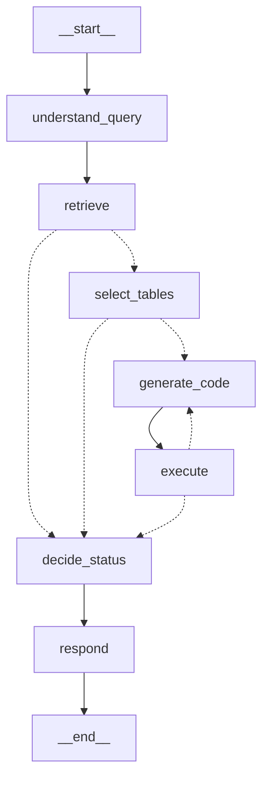

# Iteración 8 — Analista: generación, ejecución y autocorrección de código

- **Fecha:** 2026-10-07 · **Rama:** `feat/qa-tablas`
- **SHA:** ver `git log -1 --format=%H -- specs/qa-tablas-pdf-spec-plan-artifacts/iterations/08-analyst-codegen.md` (D-003)
- **Commit:** `feat(analista): generación de código, ejecución en sandbox y autocorrección`

## Criterios de éxito

Corrida final con el código definitivo, justo antes del commit (PowerShell desde la raíz, `$env:LLM_CACHE="true"`).

| # | Criterio | Comando | Resultado |
|---|---|---|---|
| 1 | VC-045, VC-047, VC-048 (grafo), VC-049 | `.venv\Scripts\python -m pytest tests/unit/test_analyst_graph.py -v` | PASS (33 passed, 12,5 s). VC-045 `test_vc045_codegen_prompt_has_exact_columns_and_program_reads_tables_by_alias` (sandbox real; alias t1/t2 = orden de `selected_table_ids`); VC-047 `test_vc047_key_error_then_fixed_code_retries_with_error_feedback` (sandbox real; 2º prompt con `KeyError` y el código anterior, `code_attempts=2`, answered); VC-048 `test_vc048_invalid_output_in_the_graph_triggers_a_retry[sin-json-final / falta-parte-covered / value-nan]`; VC-049 `test_vc049_nfr006_always_broken_code_exhausts_retries[0/1/3]` (exactamente 1+R `generate_code`, "falló la ejecución tras 4 intentos: returncode 1: KeyError…", cannot_answer). Extra: `extract_code`, rechazo AST / código vacío / texto sin código, partial con `missing` del código + prompt de respond (conversiones, tablas y páginas, código), traza fake con 2 spans de `generate_code`/`execute` |
| 2 | NFR-006 con fakes | incluido en 1 (`test_vc049_nfr006_…`) | PASS: `len(chat.calls) == llm_calls == 4 + MAX_CODE_RETRIES` (R ∈ {0, 1, 3}) y 1 llamada de embeddings |
| 3 | VC-043, VC-051, VC-081 | `.venv\Scripts\python -m pytest -m integration tests/integration/test_analyst_real.py -v` | PASS (6 passed, 33,5 s con caché): VC-040, sin relación → cannot_answer, una tabla (7,9 / 0,3), VC-043 (≥ 2 tablas, una de cada EPH, todas covered, 8,7 / 8,2 / 0,5), VC-051 (conversión "miles de personas → millones de personas", 1,164, respuesta con tabla y "pág. 8"), VC-081 (`list_runs(is_root=True)`: run `analyst:<60>`, hijos = los 7 nodos, `generate_code`/`execute` × `code_attempts`, metadata `status`, `selected_table_ids`, `code_attempts`) |
| 4 | CLI con pregunta de una tabla real → `answered` verificado a mano | `.venv\Scripts\python -m agents.analyst "¿Cuál fue la tasa de desocupación del total de 31 aglomerados en el 2° trimestre de 2026 y cuánto cambió respecto del 2° trimestre de 2025?"` | PASS (exit 0): `status=answered`, p1 = 7,9 %, p2 = 0,3 p.p., 1 intento, 4 llamadas de chat, 1 de embeddings, run `b34e61d9-574b-42c2-8059-32ec73f2843e`. A mano: EPH 2T2026 pág. 8, Cuadro 1.3, fila "Tasa de desocupación": 7,6 (2T2025) … 7,9 (2T2026) → 7,9 y +0,3 ✔ |
| 5 | Suite sin red, lint, secretos | `pytest -m "not integration"`; `ruff check .`; `git grep -nE "(sk-[A-Za-z0-9]{16,}\|pcsk[_]\|lsv2[_])"` y `--cached`; `git ls-files .env` | PASS (304 passed, 20 deselected, 44,9 s ≤ 60; "All checks passed!"; greps vacíos, `.env` no trackeado) |
| 6 | Artefactos | revisión | PASS: este record (comandos, mermaid), `CONTEXT.md` (grafo final, sin el stub en *Known gaps*), D-032..D-034 |

Fallas durante la iteración (corregidas antes de la corrida final): VC-043 daba `cannot_answer` porque el selector exigía una sola tabla con ambos trimestres (D-034).

## Preguntas reales probadas (índice de producción, `LLM_CACHE=true`)

| Pregunta | Estado | Valor | Tablas | Intentos | Verificación a mano |
|---|---|---|---|---|---|
| Tasa de desocupación 31 aglomerados 2T2026 y cambio vs 2T2025 | answered | 7,9 %; +0,3 p.p. | `b0a700bac4db8192-p008-t0` (+ p012 o la 1.3 de 2T2025 según la corrida; el código usa solo t1) | 1 | Cuadro 1.3, EPH 2T2026 pág. 8: 7,6 → 7,9 ✔ |
| Tasa de desocupación de GBA 2T2025 y 2T2026 y variación (VC-043) | answered | 8,7 %; 8,2 %; −0,5 p.p. | `2c14158b26aed2d1-p018-t0` + `b0a700bac4db8192-p020-t0` | 1 | Cuadro 3.3 EPH 2T2025 pág. 18: GBA 8,7; Cuadro 3.4 EPH 2T2026 pág. 20: GBA 8,2 ✔ |
| Personas desocupadas 31 aglomerados 2T2026 en millones (VC-051) | answered | 1,164 millones (conversión miles → millones) | `b0a700bac4db8192-p008-t0` | 1 | Cuadro 1.3 pág. 8: "Población desocupada" 1.164 (miles) ✔ |
| Mayor desempleo regional en 2023 vs promedio nacional (VC-040) | cannot_answer | — | p015 (2T2025) + p020 (2T2026) marcadas covered | 1 | Correcto: los PDFs cubren 2T2024–2T2026; el **código** reportó "falta la tabla de 2023" para ambas partes |
| Personas desocupadas en GBA 2T2025 y 2T2026 y diferencia | 1ª corrida: partial (p1 con solo 683); final, tras la regla "todo o nada": cannot_answer | — | p017 (2T2025) + una tabla de 2T2026 sin ese dato | 2 (1ª) / 1 (final) | 2T2025 pág. 17: 683 ✔; la tabla de 2T2026 con el dato (p019, GBA 656) **no fue recuperada**: limitación de recuperación |
| Goles de Messi en Qatar 2022 | cannot_answer | — | ninguna | 0 | Correcto |

## Grafo final (`build_analyst_graph(deps).get_graph().draw_mermaid()`, sin config ni estilos)

## Archivos

Cambiados: `agents/analyst/nodes.py` (`generate_code_node`, `execute_node` reales, `route_after_execute`, `extract_code`, `table_aliases`, `AnalystDeps.sandbox`), `agents/analyst/prompts.py` (codegen, feedback, respond con código y coma decimal, reglas 1/4 del selector), `agents/analyst/graph.py` (arista `execute → generate_code | decide_status`), `agents/analyst/state.py` (docstring), `agents/analyst/__main__.py` (muestra código, ejecución y conversiones), `tests/unit/test_analyst_graph.py` (`FakeSandbox`, 13 tests nuevos, stub test reemplazado, mermaid y traza actualizados), `tests/integration/test_analyst_real.py` (4 tests nuevos), `CONTEXT.md`, `DECISIONS.md` (D-032..D-034), este record. Sin dependencias nuevas; `services/` sin cambios.

## Desvíos del plan

1. **Prompt de selección modificado** (Iteración 7) para que acepte combinar tablas (D-034): sin eso VC-043 no podía pasar.
2. **`AnalystDeps.sandbox`** inyectable (no estaba en el plan) para testear el grafo con un `FakeSandbox` y mantener la suite ≤ 60 s.
3. **`respond` recibe el código** ejecutado (para la "explicación breve del cálculo" de FR-040) y una regla de coma decimal ("1.164 millones" era ambiguo en es-AR).
4. **Test extra de integración** con la pregunta de una tabla (el valor verificado a mano queda como regresión).
5. `run_url` sigue `None` (FR-055 → Iteración 9): no hay URL sin una llamada extra a LangSmith.

## Problemas encontrados / gotchas

- Cuadro 1.3 de INDEC repite rótulos ("Tasa de la población total", "Mujeres") en los bloques Actividad/Empleo/Desocupación: por eso el prompt lista la primera columna fila por fila con índice; el LLM filtra a partir de la fila del bloque.
- El selector es no determinístico con temperatura 0 entre versiones de prompt: con D-034 a veces cubre períodos inexistentes (lo frena el código) y agrega tablas que el código no usa (aparecen en "tablas usadas" de la respuesta).
- Recuperación: "Población de referencia por región" (EPH 2T2026 p019) no aparece para "personas desocupadas en GBA"; candidata a pregunta de evaluación con fallo conocido o a mejorar consultas en el plan.
- Cada ejecución real del sandbox tarda 1–8 s según la carga (arranque + `import pandas`).
- `partial(route_after_execute, deps=deps)` funciona como función de ruteo condicional; LangSmith lo muestra colgado del nodo `execute`, no del raíz.

## For the next iteration

- **Iteración 9 (UI):** `run_analyst(question, deps, on_update=...)` emite `generate_code`/`execute` una vez por intento (claves en `CONTEXT.md`); mostrar `result.code`, `result.execution.stdout/stderr/status/error`, reintentos = `code_attempts - 1`, `result.selected_tables` (archivo + páginas) con `TableStore.load_table`, `results`/`conversions` (ocultar con `cannot_answer`), `missing` con `related_table_note`. Armar `run_url` a partir de `run_id` (FR-055). Validar pregunta vacía / > 1 000 caracteres antes de `ask` (FR-056).
- **Iteración 10 (eval):** usar como semillas las preguntas de la tabla de arriba (valores verificados); incluir una multitabla entre ediciones (GBA 8,7/8,2), la de 2023 (`cannot_answer` por período, VC-053) y medir el efecto de D-034 y de la recuperación.
